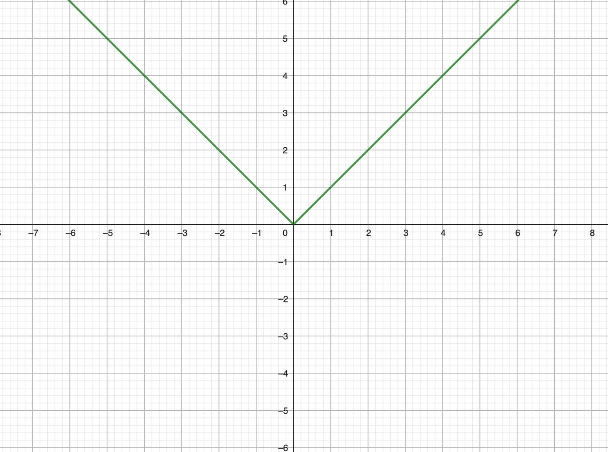

Def. 1.6 (1805 Piano) FÜr 2 Mengen M, N heinßt eine Teilmenge $f \subset M \times N$ (graph einer) Funktoin oder (Graph einer Abbildung) mit definitionsbereich M und Wertebereich N, falls es für jedes $a \in M$ genau ein $b \in N$ gibt mit $(a, b) \in f$ dises b heißt Wert $f(A)$ von  F an der stelle a.

Schreibweise: 
$f: M \to N$
$a \mapsto f(a)$

Keine Funktion:

Beisp: Auf einer Menge M ist die $\mathrm{id}_{M} = \{(a, a) | a \in M\} $ die Identitätsabbildung D.h. also $\mathrm{id}_{M} (a) = a$
Auf $\mathbb{N}_0$ ist $\{(a, a+1) | a \in \mathbb{N}_0\}$ die Nachfolgerfunktion 
$\mathbb{N}_0 to \mathbb{N}_0$
$n \mapsto n+1$

Und g: $\mathbb{Q} \setminus \{0\} \to \mathbb{Q}$ ist eine Funktion, die nicht auf ganz $\mathbb{Q}$ def. ist.
$x \to \frac{1}{x}$
ähnlcih ist $\tilde{g}: \mathbb{Q} \setminus \{0\}$ \to $\mathbb{Q} \setminus \{0\}$ $x \mapsto \frac{1}{x}$
oder: $\hat{g}: ]0;1[ \to \mathbb{Q}^+$
Für $A \subseteq M, B \subseteq N$ heißen $f(A) = \{b \in N | es gibt ein a \in A mit f(a) = b\}$ Das bild von A unter der abbildung f. und $f^{-1}(B):= \{ a \in M| f(a) \in B\}$ Funktion $f: A $

Beisp: $g(\mathbb{Q} \setminus \{0\}) = \mathbb{Q} \setminus \{0\} = \mathbb{Q}\setminus \{0\}, g(\mathbb{Q}^+) = \mathbb{Q}^+$
Def. 1.7 zu Funktionen $g: M \to Q$, $F: N \to P$ heißt
$f \circ g: g^-1(N \cap Q) \to P $
$a \to f(g(a))$ 

Beisp: Die Verküpfung von $g: x \mapsto \frac{1}{x} \text{ mit }  f: n \to n+1$ ist $g \circ f: \mathbb{N}_0 \to \mathbb{Q}$ $n \mapsto \frac{1}{n+1}$

Lemma 1.8: Für Funktionen f, g, h ist $(f \circ g) \circ h = f \circ (g \circ h)$
Bew: für $a \in M$ ist $(f \circ g) \circ h (a) =(def)= (f \circ g)(h(a))$ = $f(g(h(a)))= f (g \circ h (a)) = f \circ (g \circ h) (a)$ Die  rechte und linke seite haben dieselben werte, sind also gleich.

Def. 1.9 eine Funktion $f: M \to N$ heißt 
1: Surjektiv falls $f(M) = N$,
Injektiv, falls für alle $b \in  \mathbb{N}$ das Urbild $f^-1(\{b\})$ höchstens aus einem element besteht. und bijektiv wenn sie surjektiv und injektiv ist.  

Eine Funktion ist 
surjektiv                                    mindestens
injektiv,, Falls jeder wert in $\mathbb{N}$  höchstnes einmal vorkomm
bijektiv                                      genau

Beispiel: $|x| : \mathbb{Q} to \mathbb{Q}

$f_1: \mathbb{Q} \to  \mathbb{Q},$ $x \mapsto |x|$ nicht surjektīv nicht injektiv da z.b. 5 bei -5 und 5 getroffen wird.

für eine bìjektive Abbildung $f: M \to N$ ist $f^-1$
$b \mapsto a \text{ mit } f(a) = b$ ïnsbes. ist $f ^{-1}(f(a))= a, f ^{0} \circ f = \mathrm{id}_{M} $ und andersrum Wenn (a, b) im graph von f  liegt, mit $f(a) = b$ dann ist (b,a) im graph von $f^-1$