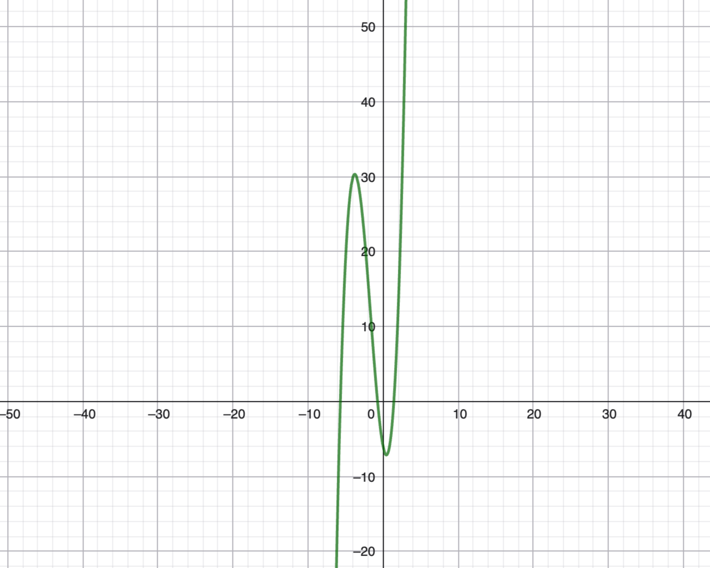

Funktion f: $M \to N$ ist eine Teilemenge von M $\times$ N, sodass für ALLE  m $\in$M es genau ein paar $(m, n)$ mit n $\in$ N existiert. 

Schreibweise: Funktionswert f(m) = n an der stelle M. 
f ist bijektiv, falls zu jedem n genau ein solches Paar (m, n) im graphen von f existiert. Die Umkehrfunktion $f ^{-1}:N \to M$ ist dann eind. durch  $f ^{-1}(n)$ =  das eindeutig bestimmte m mit f(m) = n bestimmt. 
Lemma 1.10 Seien M, N, P Mengen, $g: M \to N$, $f: N \to P$ bijektiv. Dann gilt: $(f \circ g) ^{-1} = g ^{-1} \circ f ^{-1}$  und $(f ^{-1}) ^{-1} = f$ 
Bew: Wegen $f(n) = p \iff f ^{-1}(p) = n$ ist f die umkehrfunktion zu $f ^{-1}$  
Aus $f(g(m)) = p$ folgt $g(m) = f ^{-1}(p)$ und daraus $m = g ^{-1}(f ^{-1}(p)) = (g ^{-1} \circ f ^{-1}) (p)$, also ist $(f \circ g)^{-1} = g ^{-1} \circ f ^{-1}$

Rekursionssatz on Dedekind (1888) Sei M eine Menge, a $\in$ M und $H: \mathbb{N} \times M \to M$ sei eine Rekursionsvorschrift Dann gibt es genau eine Abb. $f: \mathbb{N}_0 to M$ mit f(0) = a, 2.$f(n+1) = H(n, f(n))$ 
Also $f(0) = a$, f(2) = $H(0, f(0)), f(2) = H(1, f(1)= H(1,H(0, a))$
Def 1.12 Die Fakultät sei die Fkt. $\mathbb{N}_0 \to \mathbb{N}_0$
$n \to n!$ mit 0! = 1 und $(n+1)!=(n+1)n!$ Somit gilt für die fakultät $0! = 1, 1! = 1*0!, 2! = 2*1! = 2...$ Hier ist H(n, k) = (n+1)*k 
Bew, Von 1.11: zunächst überprüfen wir mit vollständiger Induktion , dass für jedes $n \in \mathbb{N}_0$ eine solche funktion definieren kann, $f_n : \{0, ..., n\} \to M$ existiert:
Induktionsanfang: f$_0$(0) = a liefert $f_0: \{0\} to M$ Induktionsschritt: Angenommen für ein bestimmtes gegebenes n $\in  \mathbb{N}_0$ ex. $f_n: \{0, ..., 1\} \to M$ 
Setze dann $f_{n+1}: \{0, .., n+1\} \to M$
$k \mapsto \begin{cases}f_n(k) \text{ für k kleiner n } \\ H(n, f_n(k))\text{ für  } k = n+1 \end{cases}$
Dann setzte den graphen von f als die Vereinigung der $f_n$, Graph von $f = \bigcup_{n \in \mathbb{N}_0} \text{ graph von }  f_n$ $\square$
