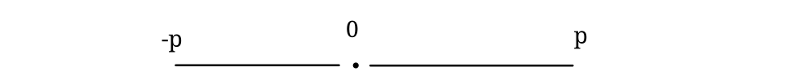

1.3 Reele Zahlen
Def. 1.18 Sei K ein körper und P $\subset$ K mit 
O1) Trichotomie Für jedes a $\in$ K  gilt entweder a $\in$ P oder a = 0 oder -a $\in$ P
O2) (Abgeschlossenheit bzgl. Addition und Multiplikation) Für alle a, b $\in$ P ist auch a+b, a $\cdot$ b $\in$ P 
Dann heißt (K, P) ein angeordneter Körper, die elemente von P heißen Positiv, und die von -P negativ. Schreibweise: 
a > b, b<a für a-b $\in$ P
a $\geq$ b $\leq$ a für a-b $\in$ $P \cup \{0\}$

Beispiel: 
1) $\mathbb{Q}$ mit P = $\{\frac{p}{q}| p, q \in \mathbb{Z}^+\}$ ist ein geordneter Körper
Auf $\mathbb{F}_2$ gibt es keine anordnung: 0 $\mathbb{F}$_2 kann wegen der trichotomie nicht in P liegen. 

 für P $\neq$ $\emptyset$ ist wegen $1_{\mathbb{F}_2} \in  P$ für P = $\{1\}$ dann folgt 0 $\in$ P, was wieder (01) wiederspricht.  
Lemma 1.19 Die Relation >, erfüllt für a, b, c, $\lambda$ $\in$ K die Rechenregeln
1) Transitivität a>b und b>c $\implies$ a > c
2) a>b $\iff$ -a < -b
3) a>b $\iff$ a+c > b+c.
4) a>b und c>0 impliziert ac > bc
5) a $\neq$ 0 $\implies$ $a^2$> 0 und somit $1 = 1^2 > 0$
6) a>0 $\implies$ $\frac{1}{a} >0$
7) falls a > b und 0< $\lambda$ <1, so ist a > $\lambda$ a +(1-  $\lambda$)b> b

Bew.: 
1) Mit a-b $\in$ P und b-c $\in$ P ist nach (O2) 
$$a-c = (a-b)+(b-c) \in P.$$
2) a - b $\in$ P  bedeutet gerade (-b) - (-a) $\in$ P
3) a -b $\in$ P bedeutet für jedes c $\in$ K, dass (a+c) - (b+c) $\in$ P
4) Falls a-b $\in$ P und c $\in$ P so gilt nach  (O2) auch das ca - cb $\in$ P
5) Für a $\in$ P ist nach (O2) auch a $\cdot$ a $\in$ P. Falls -a $\in$ P, ist ebenfalls a $\cdot$ a $\in$ P 
6) Aus a>0, $\frac{1}{a} <0$ folgt $-1 = \frac{1}{a} \cdot a >0$ was, da $-1 < 0$ einen wiederspruch liefert.
7) Aus (o2) folgt $\lambda (a-b) > 0 \text{ und } (1- \lambda )(a-b) >0$ also ist mit 3) $$\lambda a + (1-b) > b \text{ und } \quad -\lambda a - (1-\lambda ) \cdot b > -a$$
Lemma 1.20: Sei K ein geordneter Körper. Dann gibt es eine 
kanonitsche injektive Abbildung $\iota : \mathbb{N}_0 \to  K$ sodass
$\iota(1_\mathbb{N}) = 1_K$, $\iota (n+m) = \iota (n)+\iota (m)$ und $\iota (n \cdot   m) = \iota (n)\cdot \iota (m)$
Kanonisch bedeutet nicht von weitere Wahlen abh. also Durch gegebenes bereits eindeutig bestimmt.  
Für allg. Körper ist diese Aussage falsch, wie das Beispiel $\mathbb{F}_2$ zeigt.
Idee: Anschaulich sollte nach den Ersten beiden Aussage über $\iota$
Bew: Mit dem Rekursionssatz 1.11 def. wir $\iota (0) = 0$ , $\iota (n+1) = \iota (n) + 1$
Die Add. und Mult. in $\mathbb{N}$ wird über die nach             
