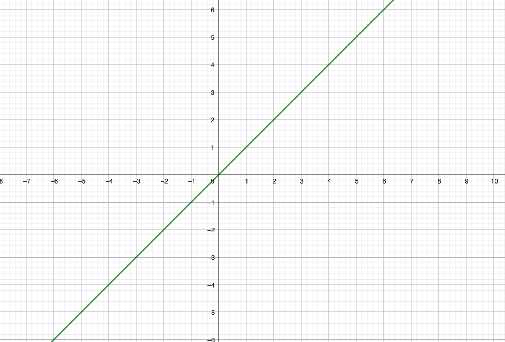
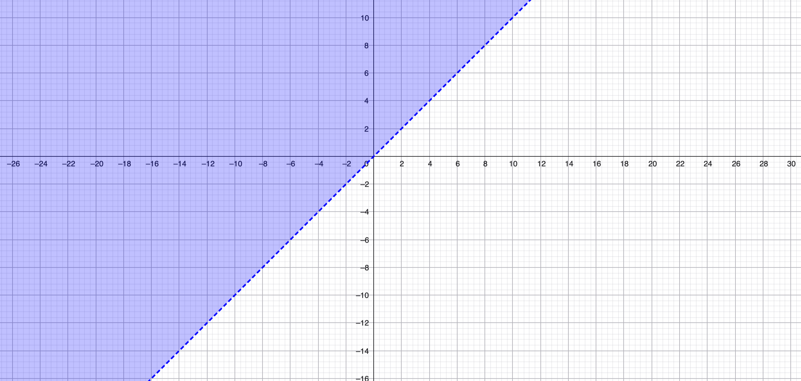
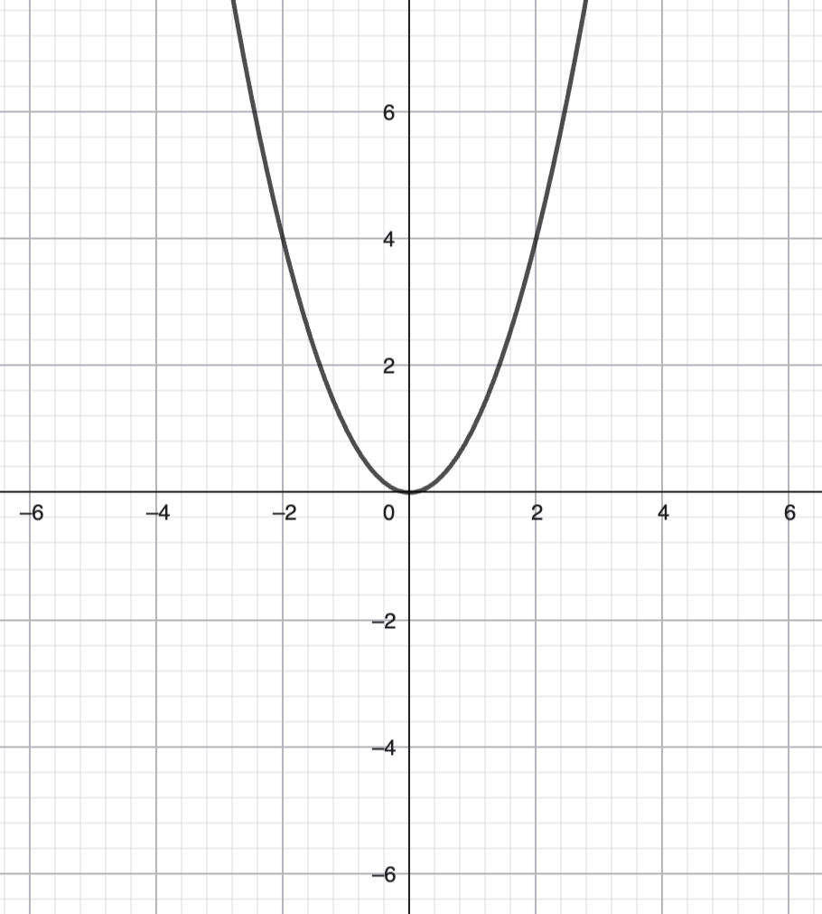
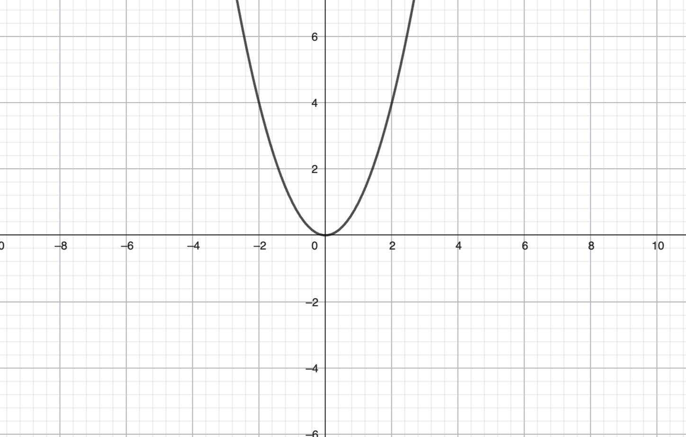

1.10 Def
(a) Seien A, B Mengen. Das cartesische Produkt von A und B ist $A \times B = \{(a, b) | a \in A, b \in B\}$ wobei für x, y, $\tilde{x}, \tilde{y}$ gilt: $(x, y) = (\tilde{x}, \tilde{y}) \iff (x = \tilde{x}, y = \tilde{y})$ zum beispiel kann $(x, y) = \{\{x, y\}, \{x\}\}$
(b) Für endlich viele Menge $A_1, ..., A_n$ ($n \in \mathbb{N}_0$) hilden wir entsprechend $$A_1 \times A_2 \times ... \times A_n = \{(a_1, a_2,...,  a_n) | a_i, \in A_i\} = \prod_{i=1}^{n} A_i$$ wobei für $x_1, ..., x_n, \tilde{x_1},... ,\tilde{x_n}$ stets gilt: $(x_1, ..., x_n) = (\tilde{x_1},..., \tilde{x_n}) \iff (x_1 = \tilde{x_1},...,  x_n = \tilde{x_n})$ 
(c) Eine (binäre) Relation auf einer Menge A ist eine Teilmenge $R \subset A \times A$; allgemeiner können Relationen auf einem Mengenpaar A, B betrachtet werden: $R \subset A \times B.$
1.11 Bsple:
 - euklidische Ebene $\mathbb{E}_2 = \mathbb{R}^2 = \mathbb{R} \times  \mathbb{R}$
-

$\{(a, a+b) | a \in \mathbb{R}\}$ kann geom. als Gerade interpretiert werden. oder auch als Relation auf $\mathbb{R}$  nämlich die Gleichheitsrelation $=_{\mathbb{R}}$ für Reele Zahlen

$\{(a, a+b^2)|a, b \in \mathbb{R}\}$

die Kleinergleichrelation $\leq_{\mathbb{R}}$ auf $\mathbb{R}$

# §2: Abbildungen und Bijektionen

(2.1) Motivation 
$A \to B$, $a \to b_a$

Bspl: $x \mapsto x^2 für A = B = \mathbb{R}$
$\{(x, x^2) | x \in \mathbb{R}\}$
(2) $\pi  =3,141592653589$
$\mathbb{N} \mapsto \{0, 1, 2, ..., 9\} n \mapsto \text{ nte Nachkommastelle von } \pi$ also $1 \mapsto 1, 2 \mapsto 4, ...$
| 1   | 2   | 3   | 4   | 5   |
| --- | --- | --- | --- | --- |
| 1   | 4   | 1   | 5   | 9   |

(2.2) Def  Seien A, B Mengen. eine Abbildung $\alpha$ von A nach B, i.z. $\alpha: A \to B$, ist eine Relation
$\alpha \subset A \times B$ mit der (wesentlichen) Eigentschaft: für jedes $a \in A$ gibt es genau ein $b \in B$ mit $(a, b) \in \alpha$ 

Für eine Abbildung $\alpha  A \to B$ heißt A der Definitionsbereich und B ein Wertebereich von $\alpha$ Ist $(a, b) \in \alpha $ So schreiben wir prägnanter: $a \alpha  = b$, $a.\alpha  = b$, $(a)\alpha  =b$ $a^{\alpha} = b$ 
!: In der Analysis würden wir fast immer $\alpha (a) = b$ schreiben. und Wir nennen $a \alpha$ das Bildelement von A unter der Abbildung $\alpha$ Schließlich heißt $\text{ Bild }(\alpha) = A _{\alpha } = \{a \alpha | a \in A\} \subset B$ das (gesamte Bild von $\alpha $) (z.B für $\mathbb{R} \to  \mathbb{R}, x \mapsto x^2$) das bild gerade $\mathbb{R}_+$
Bem. Für uns sind die Abb $sin: \mathbb{R} \to \mathbb{R}$ und $\sin() \mathbb{R} \to [-1, 1]_{\mathbb{R}}$ gleich. 
Die leere Abb ist $\emptyset :\emptyset \to \emptyset$
2.3 Def Seien A, B Mengen 
(a) Abb(A, B) = $\{\alpha | \alpha : A \to B\}$ Die Menge aller Abb von A nach B.
(b) Eine Abb. $\alpha A \to B$ heißt ijektiv, falls aus $a \alpha = \tilde{a}\alpha $ stets $a = \tilde{a}$ folgt.
(c) Die Abb $\alpha $ bildet A surjektiv auf B ab, falls $\text{ Bild(} \alpha) = B$ Schließlich heißt $\alpha A \to B$ eine Bijektion von A auf B (kurz. bijektiv) von A auf B, falls $\alpha$ injektiv ist und surjektiv auf B ist.

Bem: Mit zunehmender Erfahrung schreiben wir (auch) kurz: "$\alpha A \to B$ ist Surjektiv bzw. bijektiv."

2.4 Bspl

(a) Die abb $f: \mathbb{R} to \mathbb{R}, x \mapsto x^2$ is weder injektiv noch surjektiv auf $\mathbb{R}$
Ihre Einschränkung auf $\mathbb{R}_{\geq 0}$ d.h. die Abb. $g: \mathbb{R}_+ \to \mathbb{R}_+$ ist eine Bijektion von $\mathbb{R}_+$ auf sich

Seien $a, b \in \mathbb{R}$ die Abbildung 
$\alpha = \alpha _{a, b}: \mathbb{R}\to \mathbb{R}, x \mapsto ax+b$ 
Behauptung: für $a \neq 0 \text{ ist }  \alpha = \ alpha_{a, b}$ eine Bij von $\mathbb{R}$ auf sich.
Bew: Sei $a \neq 0$. Injektivität: Seien $x, y \in \mathbb{R}$ mit $x \alpha  = y \alpha $. Dann gilt  $ax+b = ay+b$, also $ax = ay$ da a nicht null ist gilt:  $x = y$. 
Surjektivität: Sei $y \in \mathbb{R}$. Gesucht ist ein $x \in \mathbb{R}$ mit $x \alpha  = y \alpha $ Setze $x = a^{-1}(y- b)$ Dann ist tatsächlich $x \alpha = a(a^{-1}(y-b)) +b = y$ 
(c) für beliebige Mengen A gilt: 
$Abb(\emptyset ,  A) = \{\emptyset \}$; für $A \neq  \emptyset $ ist $Abb(A, \emptyset ) = \emptyset $
Die Menge $Abb(\{1, 2, 3\}, \{0, 1\})$ besteht aus genau $8$ elementen. In solchen Situationen verwenden wir häufig  Abbildungstafeln zb. bezeichnet
$\begin{pmatrix} 1 & 2 & 3 \\ 0 & 1 & 1 \end{pmatrix}$ die Abb. $\{1, 2, 3\} \to {0, 1}$ die durch $1 \mapsto 0$, $2 \mapsto 1$ und $3 \mapsto 1$ gegeben ist. streng genommen wäre die abb. $\{(1, 0), (2, 1), (3, 1)\}$

(d) Sei A eine Menge. Für $T \subset A$ bezeichne
$$\iota : A \mapsto \{0, 1\}, a \to \begin{cases}0 \text{ falls } a \notin T \\ 1 \text{ falls } a \in T  \end{cases}$$ die zugehörige Indikatiorfunktion.
Dann liefert $$\iota: P(A) \to Abb(A \{0, 1\}), T \to \iota_T$$ eine Bijektion. Mithilfe dieser von $\iota$ lassen sich die enfachen "Rechenregeln" für $\cup \cap \setminus $ übersetzen (und damit verständlich machen) in entsprechende Rechenregeln für Abb($A, \{0, 1\}$) über die jew. Bilder modulo 2. 
2.5 Satz & Def. 
(a) Seien A, B, C, D mengen und $\alpha A \to B$, $\beta : B \to C$, $\gamma: C \to D$ Abb. Das Kompositum (oder: Hintereinanderausführung) von $\alpha $ und $\beta $ ist die Abb. $\alpha \beta : A \to C, a \mapsto (a \alpha )\beta $ Es gilt das Assoziativgesetz  $(\alpha \beta)\gamma $ = $\alpha (\beta \gamma )$ Beide Seiten sind Abb. Von A nach D
für bel. $a \in A$ gilt: $$a((\alpha \beta )\gamma)=(a(\alpha \beta ))\gamma  =  (a(\alpha )\beta )\gamma  = (a \alpha )(\beta \gamma) = a(\alpha (\beta \gamma ))$$
Bem: Für die Hint' ausf $\alpha \beta $ haben wir implizit vorr, dass $\text{ Bild(} \alpha  ) \subset B$ im Def' ber B von $\beta$ liegt. Verzichtet man auf diese Bed, ergibt sich trotzdem eine Abb. $\alpha \beta: A_0 \to C$ mit $A_0 = \{a \in A | a \alpha \in B\}$ mit entspr. eingeschr. Def' Bereich. 
(b) Die identische Abb. auf einer Menge A ist $id_A: A \to A, a \mapsto a.$ Für jede Abbildung $\alpha: A \to B$ ist $id_A\alpha = \alpha = \alpha id_B$
