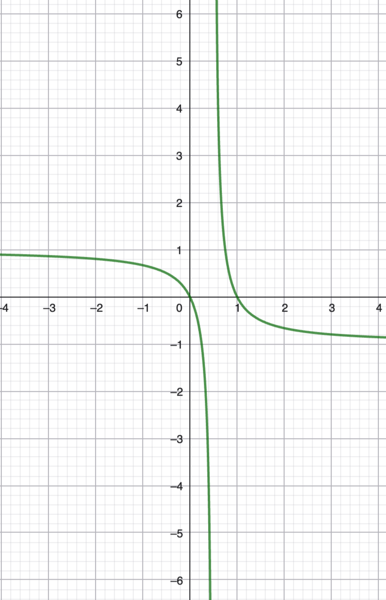

(3.1) $A \approx B \iff_{\text{ def } \exists \alpha : A \to B}$ bijektiv (oder auch |A|=|B|)
(3.2) $\mathbb{N} \approx \mathbb{Z} \approx \mathbb{Q}$ aber $\mathbb{N} \not \approx \mathbb{R} $ dazu $(0, 1)_{\mathbb{R}} to \mathbb{R}, t \to \begin{cases}\frac{1-|2t-1|}{2t-1}: &t \neq \frac{1}{2} \\ 0: &t= \frac{1}{2}\end{cases}$ 

liefert $(0,1)_\mathbb{R} \approx \mathbb{R}$ Zeige nun $(0, 1)_\mathbb{R}$ $\not\approx$ $\mathbb{N}$ Mittels Cantorschen Diagonalargument. Verwende: Jede Reele Zahl $x \in (0, 1)_\mathbb{R}$ lässt sich eindeutig als Fließkommazahl in Dezimalschreibweise schreiben, wenn keine perioden der ofrm $...999...$ verwendet werden. (0,32999... = 0,33)
Wiederspruchsannahme: $(0, 1)_\mathbb{R} \approx \mathbb{N} \implies \text{ liste } $

$$\begin{aligned}
x_1 &= 0,x_{11}x_{12}x_{13} \dots  \\
x_2 &= 0,x_{21}x_{22}x_{23} \dots \\
x_3 &= 0,x_{31}x_{32}x_{33} \dots \\
x_4 &= 0,x_{41}x_{42}x_{43}\dots 
\end{aligned}$$
*** Bild für Diagonalisierungsargument einfügen***
 mit ziffern $x_ij \in \{0, 1, ..., 9\}$ Dann liegt $y = 0, y_1 y_2, ...$ mit ziffern $y_i = \min\{1, 2, 3, ..., 8\} \setminus \{x_{ii}\}$ 
(3.3) Kontinuumshypothese-Frage

(1) sei X $\subset$ $\mathbb{R}$ mit $|X| = \infty$ gilt ann bereits $X \approx \mathbb{N}$ oder $X \approx \mathbb{R}$
Gödel (1939) Cohen (1963): unabhängig von Den ZF-Axiomen, könnten wahlweise (1) oder $\neg$(1) als weiteres Axiom hinzunehmen, ohne schaden.

Kapitel II: Vektorräume:
§ Körper und Vektorräume 
(4.1) Def. Ein Körper K = (K, +, $\cdot$) betstht aus einer Trägermenge K sowie zwei verknüpfungen, Addition + und Multipl. $\cdot$,
$$+: K \times K \to K, (a, b) \mapsto a+b$$
$$K \times K \to K, (a, b) \mapsto a \cdot b  $$
(A1)$\forall a, b, c \in  K: (a+b)+c = a+(b+c)$
(A2) $\forall a, b \in K: a+b = b+a$
(A3) es ex genau ein elmt. in K welches mit 0 = $0 _{K}$ bezeichnet wird für das gilt $\forall a \in K: a+0 = 0+a = a$
(A4) Zn jedem a $\in$ K genau ein elmt aus K, welches mit -a bezeichnet wird, für das gilt: $a+(-a) = (-a)+a = 0.$ (später (K, +) abelsche Gruppe)
(M1) $\forall a, b, c \in K: a(bc) = (ab)c$
(M2) $\forall a, b \in K: ab = ba$
(M3) es ex genau ein elmt. in K $\setminus 0$ welches mit $1 = 1_K$ bez. wird sodass für das gilt: $\forall a \in K a \cdot 1 = 1\cdot a = a$ 
(M4) zu jedem a $\in$ K ex. genau ein elmt. in K, welches mit $a ^{-1} = \frac{1}{a}$ bezeichnet wird, für das gilt: $a \cdot a ^{-1} = a^{-1} a = 1$
Später ist ins auch (k $\setminus$ $\{0\}, \cdot $ eine abelsche gruppe) 
(D) $\forall a, b, c \in K: (a+b) \cdot c = ac+bc$
(4.2) Folgerungen
(a) $\forall a \in K: a \cdot 0 = 0 \cdot a = 0$ denn 
$a \cdot 0 = 0+ a \cdot 0 = (-a \cdot 0 + a \cdot 0)+ a \cdot 0 = -a \cdot 0 + a \cdot 0 = 0$
(b) $\forall a, b \in K: (-a)b = -(ab)$, denn $ab+(-a)b= (a+(-a))b = 0b = 0$ Aufgrund der eindeutigkeit des additiven inversen gilt also $(-a)b = -(ab)$
(c) $\forall a, b \in K: ab = 0 \implies (a=0 \lor b = 0)$, denn aus $ab = 0$ und $a \neq 0$ folgt $b = 1 \cdot b = (a^-1 \cdot a)\cdot b = a ^{-1} \cdot 0 = 0 $ sprich K ist bzgl. $\cdot$ Nullteilerfrei. 
4.3 Bspl: 
(a) $\mathbb{Q}$, $\mathbb{R}$, $\mathbb{C}$ sind körper. 
(b)Z bildet keinen körper, da auser 1, -1 kein a $\in$ $\mathbb{Z} \setminus \{0\}$ ein multipl. inverses besitzt.
(später Ring)
(c) $\mathbb{F}_2 = \{0, 1\}$
| +   | 0   | 1   |
| --- | --- | --- |
| 0   | 0   | 1   |
| 1   | 1   | 0   |

| $\cdot$ | 0   | 1   |
| ------- | --- | --- |
| 0      |  0   |    0 |
| 1       | 0    |   1  |

mit etwas geduld überprüfen sie Axiome $\implies $ $\mathbb{F}_2$ ist der körper mit 2 elementen. Änlich (durch ausprobieren) finden sich körper $\mathbb{F}_3, \mathbb{F}_4, \mathbb{F}_5$ mit jew. 3, 4, 5 elementen. aber keinen körper mit 6 Elementen. 
(4.4) Definition Sei K ein Körper. Für a $\in$ K und eine Ganze zahl m $\in$ $\mathbb{Z}$ def. wir $$ m \cdot a = \begin{cases}a+a+a+...+a \text{ n mal }  & n >0 \\ -((-m)a) &m < 0\end{cases} $$
Es gelten dann die folgenden Rechenregeln:
$m \cdot a = (m \cdot 1_K) \cdot a = ma$
sowie
$(m+n)a = ma+na$, $(mn).a = m(na)$ (üb)
(4.5) Def Sei m $\in$ $\mathbb{N}$. Bekanntlich gibt es zu jedem a $\in$ $\mathbb{Z}$ eindeutige q, r $\in$ $\mathbb{Z}$ mit $a = mq +r$ und $0 \leq r < m $ bezeichne den rest r von a bei division durch m  mit $r_m(a) \in \{0, 1, 2, ..., m-1\}$ Setze $R_m (\mathbb{Z}) = \operatorname{Bild}(r_m) = \{0, 2, ., m-1\}$
Verknüpfungen 
$+_m: R_m(\mathbb{Z}) \times R_m(\mathbb{Z}) \to R_m(\mathbb{Z}), a +_m b = r_m(a+b)$
$\cdot_m: R_m(\mathbb{Z}) \times R_m(\mathbb{Z}) \to R_m(\mathbb{Z}), a \cdot _m b = r_m(a   \cdot  b)$ hier lassen sich alle körperaxiome (außer m4) nachprüfen m4 gilt jedochj für $m \in \{2, 3, 5, 7\}$

(4.6) Satz Sei m $\in$ $\mathbb{N}$. Dann ist $R_m(\mathbb{Z})$ ein Körper, gdw m in $\mathbb{P}$ eine Primzahl ist. Bew liefern wir später (elem. Zahlentheorie).

(4.7) Def. Sei K ein Körper (bspsw K = $\mathbb{R}$ oder K = $\mathbb{F}_2$) ein Vektorraum $V = (V, +, \cdot )$ über K kurz ein K vektorraum, besteht aus einer trägermenge V sowie zwei verknüpfungen einer "Vektoraddition" und einer "skalaren multipl." 
$$+: V \times V \to V, (x, y)\mapsto x+y,$$ $$\cdot : K \times V \to V, (a, x) \mapsto a \cdot x = ax$$ welche folgenden Bed. genügen: 
(VA1): $\forall x, y, z \in V: x+(y+z) = (x+y)+z$
(VA2): $\forall x, y \in V: x+y = y+x$
(VA3): es ex genau ein +- neutrales element, bez. mit 0 = $0_V$  für das also gilt: $\forall x \in V: x + 0 = 0+x = x$
(VA4) zu jedem x $\in$ V ex. genaui ein + inverses bez mit -x für das also gilt $x+(-x) = 0$
(SM1) $\forall$ a, b $\in$ K $\forall$ x $\in$ V : $(ab)x = a(bx)$
(SM2) $\forall$ x $\in$ V: $1_k. x = x$
(SM3) $\forall$ a $\in$ K $\forall$ x, y $\in$ V: a(x+y) = ax+ay
(SM4) $\forall$ a, b $\in$ K $\forall$ x $\in$ V: (a+b)x = ax+bx
Es gilt Punkt vor strich. zur Unteerscheidung heißen elemente vonn V Vektoren und Elemente von K heißen Skalare
(4.8) Folgerungen Weitere Rechenregeln lassen sich ableiten. zum beispiel: 
(a) $\forall$ a $\in$ K, $\forall$ x $\in$ V: a $\cdot$ $0_v = 0_k \cdot x$ einzeiler beweis noch hinzufügen^
(b) $\forall$ a $\in$ K $\forall$ x $\in$ V: (-a)x = -(ax) = a(-x), insb. $(-1_k)x = -x$ beweis hier auch einfügen.
(c) $\forall$ a $\in$K, $\forall$ x $\in$ V: ax = $0_v$ $\implies $ (a = $0_k$ ) oder x = $0_V$ beweis hier auch einfügen 
für Körper und für Vektorräume nutzen wiri die kurzschreibweisen 
$a-b = a+(-b)$
